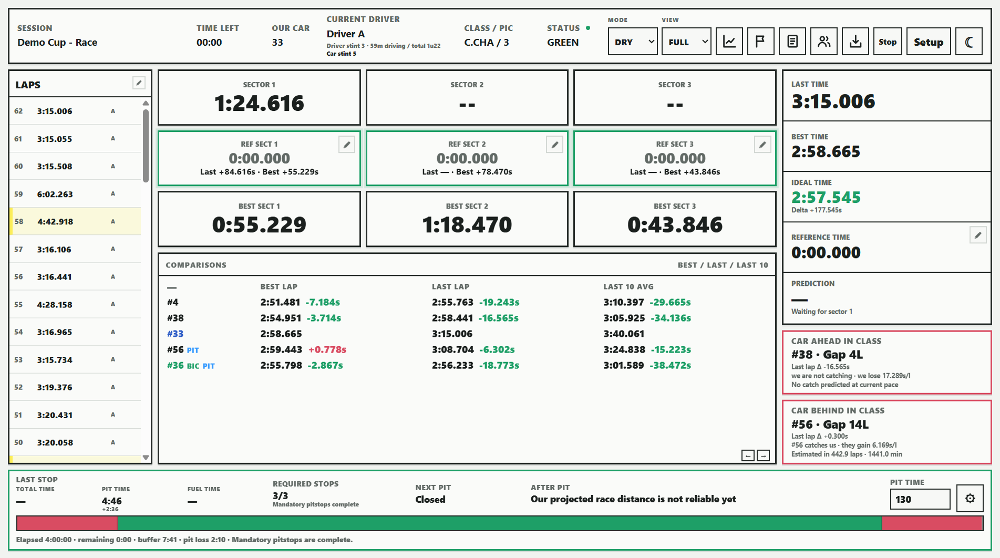
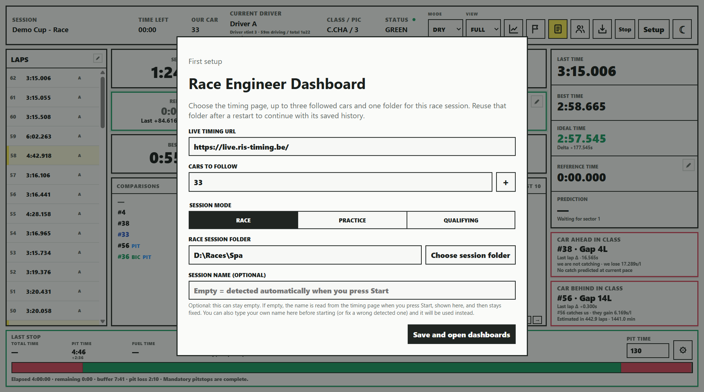
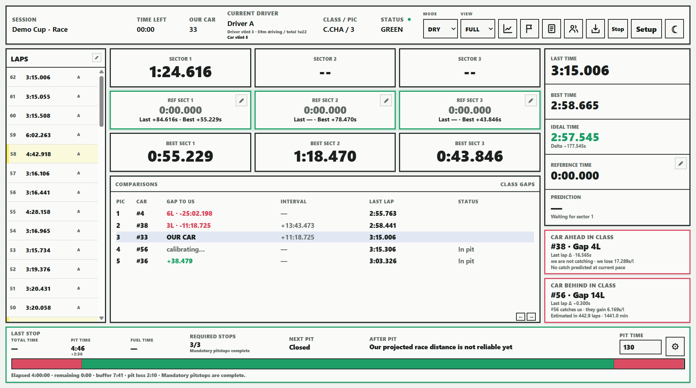
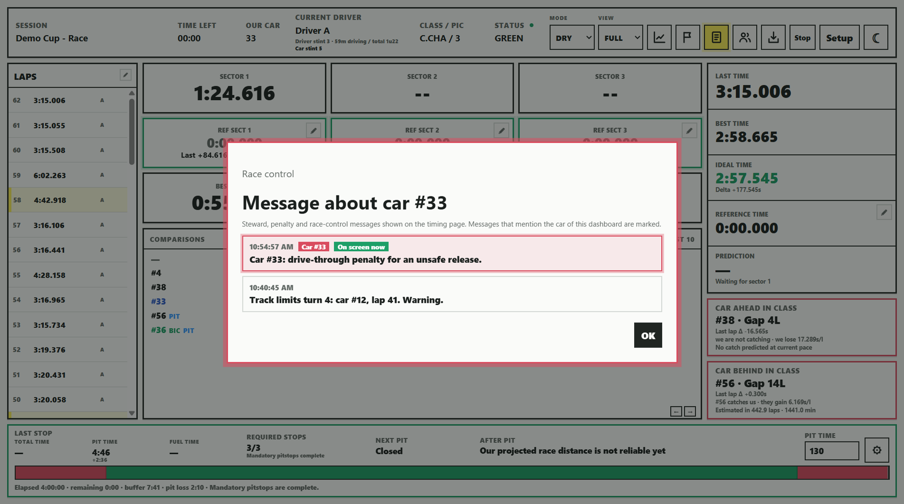
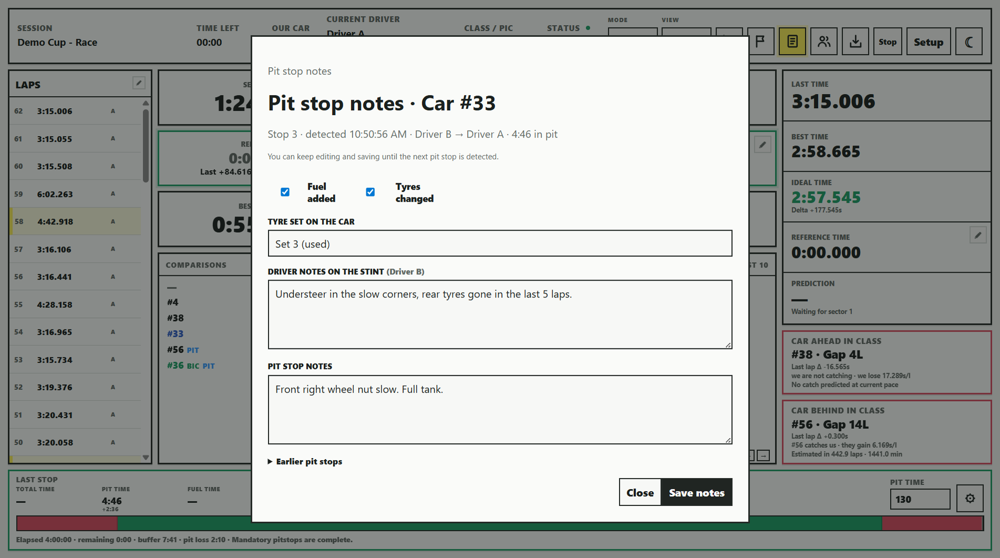
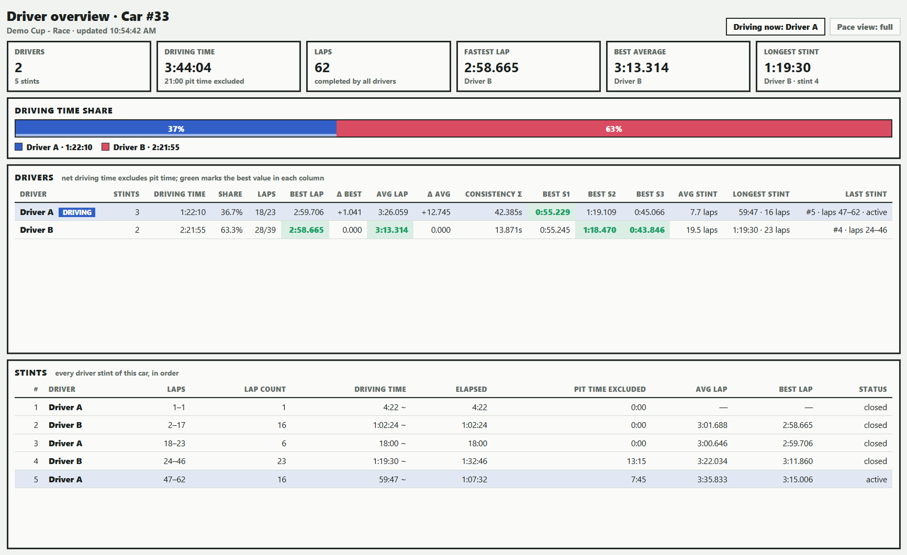
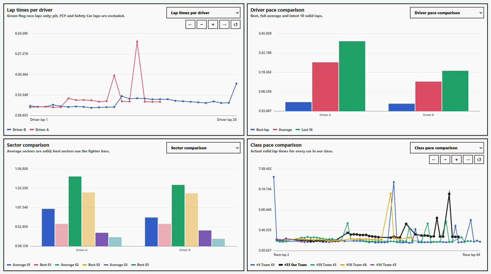
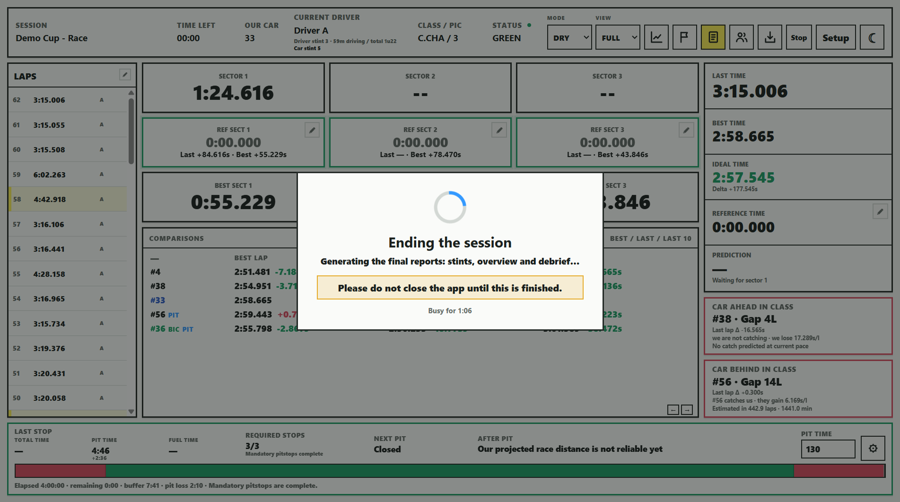
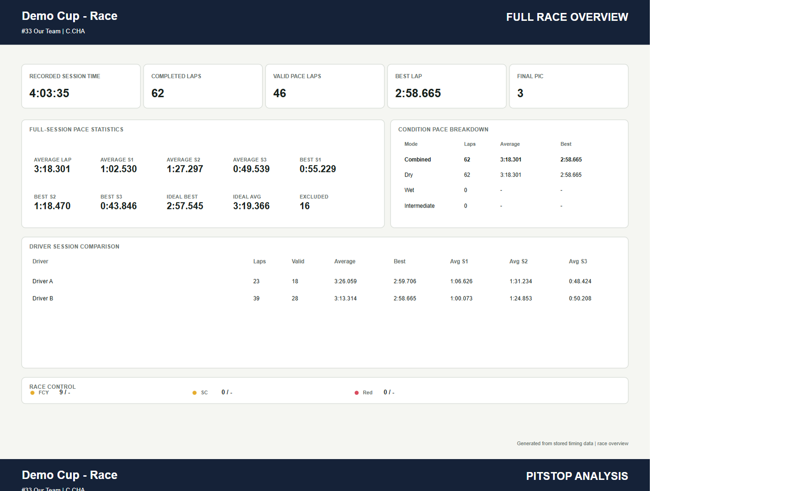

# MSTC Race Engineer Dashboard

Desktop dashboard voor live timing analyse tijdens motorsportwedstrijden.

De app leest de live timingpagina, bewaart elke ronde lokaal en zet die data om
in informatie voor een race engineer: rondetijden en sectoren, vergelijkingen met
de klasse, gaps, pitstopplanning, stints per rijder en automatische PDF- en
Excel-verslagen.



> Alle screenshots komen uit een opgenomen race met fictieve rijders- en
> teamnamen (`npx electron scripts/readme-screenshots.js`).

## Installeren

Download de nieuwste versie bij
[Releases](https://github.com/jeffmathieu/MSTC-Internship/releases/latest):

* **Windows**: `MSTC-Dashboard-Setup-<versie>-x64.exe`
* **macOS**: `MSTC-Dashboard-<versie>-<arch>.dmg`

De app zoekt bij het opstarten zelf naar updates en vraagt eerst of ze gedownload
mogen worden. Versies met `-beta` in de naam zijn testversies; die worden niet
automatisch aangeboden.

Zolang de installers niet ondertekend zijn (zie [Code signing](#code-signing))
toont Windows "Windows heeft uw pc beschermd" (kies *Meer info → Toch uitvoeren*)
en macOS "kan niet worden geopend" (rechtsklik op de app → *Open*).

## Een sessie starten



1. **Live timing URL**: de timingpagina van de wedstrijd. Ondersteund:
   GetRaceResults (`livetiming.getraceresults.com`) en RIS Timing
   (`live.ris-timing.be`).
2. **Cars to follow**: tot drie auto's; elke auto krijgt een eigen dashboard.
3. **Session mode**: race, practice of qualifying.
4. **Race session folder**: hier komt alle data. Kies dezelfde map na een crash
   of herstart om verder te gaan met de opgeslagen rondes.
5. **Session name** (optioneel): leeg laten = de naam wordt van de timingpagina
   gelezen bij *Start* en blijft daarna vast.

Druk op **Start**. Dezelfde knop wordt **Stop** zodra er data binnenkomt.

## Het dashboard

* **Header**: sessie, resterende tijd, huidige rijder (met stint- en rijtijd),
  klasse/positie en vlagstatus. Knoppen voor droog/nat, het pace-filter,
  grafieken, race control berichten, pitstopnotities, rijdersoverzicht,
  export, Start/Stop, setup en dark mode.
* **Laps**: alle rondes van onze auto. Outlaps, inlaps en neutralisaties
  (FCY/Safety Car) worden gemarkeerd en tellen niet mee in de pace. Met het
  potlood kan je een ronde manueel in- of uitsluiten.
* **Sectoren**: huidige, referentie- en beste sectoren; rechts laatste, beste,
  ideale tijd en voorspelling.
* **Comparisons**: vier tabbladen (← →) met beste/laatste/gemiddelde ronde,
  gemiddelden, sectoren en **Class gaps**. Auto's in de pit blijven in de lijst
  met een blauwe `PIT`.
* **Car ahead / behind in class**: gap, of we inlopen en wanneer.
* **Pit window**: verplichte stops, wanneer de pit open is en een tijdlijn van
  de hele race.

### Class gaps



De gaps worden berekend uit het moment waarop elke auto over de finish komt.
Daardoor kloppen ze ook op timingpagina's zonder "DIFF"-kolom (alleen GAP, of
"-- 12 laps --") en wanneer een auto een of meer ronden achter staat. Zolang een
gap nog niet zeker is staat er *calibrating…* in plaats van een gok.

### Race control berichten



Berichten van de wedstrijdleiding (track limits, straffen, …) worden bewaard in
een lijst. Bij een nieuw bericht knippert de vlagknop blauw; gaat het over onze
auto, dan opent het venster meteen met een rood knipperende rand.

### Pitstopnotities



Na elke gedetecteerde pitstop wordt de knop geel. Noteer of er getankt is,
banden gewisseld zijn, welke set erop zit en wat de rijder en het pitteam
opmerkten. De notities komen in de stint-PDF's en het debrief.

### Rijdersoverzicht



Rijtijd per rijder (zonder pittijd en zonder tijd vóór de start), aandeel,
beste en gemiddelde ronde, consistentie, beste sectoren en alle stints op een
rij.

### Grafieken



Rondetijden per rijder, pace-vergelijking, sectoren en de pace van de hele
klasse, met zoom en scroll.

## Een sessie stoppen



Bij **Stop** (of wanneer de race eindigt) schrijft de app de laatste data weg en
maakt de eindverslagen. Zolang dit venster openstaat: **de app niet sluiten**.

## Verslagen en bestanden



```
<sessiemap>/
├── RACE_SUMMARY_car-33.pdf    volledig raceoverzicht
├── RACE_DEBRIEF_car-33.pdf    post-race debrief (stints, stops, notities)
├── RACE_DATA.xlsx             alle rondes, stints en stops in Excel
├── data/                      ruwe timingdata (JSON/CSV), voor herstart na een crash
├── exports/                   tussentijdse exports via de exportknop
├── stints/car-33/             een PDF per stint en per rijder
└── backups/                   automatische backup elk half uur
```

Stint-PDF's worden al gemaakt zodra een stint eindigt (en voorlopig na elke
pitstop). De exportknop maakt op elk moment een tussentijdse PDF en Excel.

## Ontwikkelen

Vereist Node.js 20.19 of nieuwer.

```bash
npm install
```

```bash
npm run dev
```

```bash
npm test
```

* `npm run replay -- <sessiemap>`: speelt een opgenomen sessie offline af.
* `npx electron scripts/readme-screenshots.js`: maakt de screenshots hierboven
  opnieuw.
* Voor de PDF's gebruikt de app de ingebouwde Electron-printer; tijdens
  ontwikkeling kan ook de Python/ReportLab-renderer
  (`src/main/reports/requirements.txt`) gebruikt worden.

## Releases

Een tag `v*` pushen start de GitHub Actions workflow die de Windows- en
macOS-installers bouwt en een release publiceert. Tags met een streepje
(`v2.2.0-beta.3`) worden een pre-release.

### Code signing

De workflow ondertekent (en notariseert op macOS) de installers zodra de
certificaten als GitHub secrets zijn toegevoegd. Dan verdwijnen de
beveiligingswaarschuwingen en werken automatische updates ook op macOS. Welke
certificaten nodig zijn en welke secrets je moet toevoegen staat in
[docs/CODE_SIGNING.md](docs/CODE_SIGNING.md).
